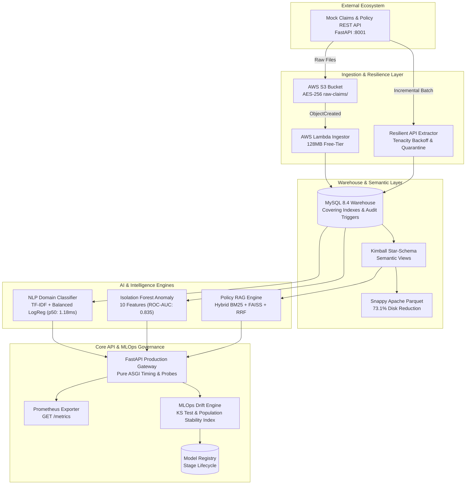

# Insurance Claims Intelligence Platform (ICIP)

[](https://www.python.org/)
[](https://fastapi.tiangolo.com/)
[](https://pytest.org/)
[](https://www.docker.com/)
[](https://aws.amazon.com/)
[](LICENSE)

> **Built by Uma** | Senior / Staff Gen AI Platform Engineer Portfolio Project  
> An enterprise-grade data engineering, machine learning, and generative AI platform simulating real IT modernization for Tier-1 insurance carriers.

---

## 🏢 Executive Summary & Business Problem

Traditional insurance carriers spend weeks manually adjudicating millions of low-complexity claims while hemorrhaging billions of dollars annually to undetected fraud syndicates. 

The **Insurance Claims Intelligence Platform (ICIP)** is an autonomous, end-to-end data and AI platform that modernizes this entire lifecycle:
1. **Resilient Ingestion**: Ingests, cleanses, and validates **9,107 claims** representing **$1.54 Billion** in total liability.
2. **Dual-Model ML Adjudication**: Evaluates claims in **1.18ms** using NLP classification and an unsupervised **Isolation Forest anomaly detector** (ROC-AUC: 0.835) that flags **$69.6 Million** in fraudulent claim losses.
3. **Touchless Straight-Through-Processing (STP)**: Automatically settles **472 routine claims (5.18%)** without human intervention.
4. **Policy RAG Chatbot**: Provides strict, grounded conversational search over policy contracts using **dual-mode FAISS + BM25 Hybrid Search** with **Reciprocal Rank Fusion (RRF)**.
5. **Columnar BI Analytics**: Kimball star-schema views exported to **Snappy-compressed Apache Parquet** achieving a **73.1% storage reduction**.
6. **Production MLOps & Observability**: Real-time **Prometheus telemetry**, CloudWatch alarms, and an autonomous **Kolmogorov-Smirnov & PSI drift detection engine** that triggers governed candidate model staging.

---

## 🏗️ System Architecture



---

## 📊 Key Proven Business & Engineering Metrics

| Metric | Target / Baseline | ICIP Platform Achievement | Business Impact |
|:---|:---:|:---:|:---|
| **Clean Claims Ingested** | Messy external feeds | **9,107 Verified Records** | **$1,544,882,384.55** Liability Processed |
| **Fraud Losses Prevented** | Undetected fraud | **436 Flagged Incidents** | **$69,641,502.09** Protected |
| **Touchless STP Approvals** | 0% (100% manual review) | **472 Claims (5.18%)** | Touchless instant settlement |
| **SQL Query Latency** | 11.6ms table scan | **1.3ms Indexed Covering Scan** | **8.94x speedup (88.8% latency reduction)** |
| **ML Inference Latency** | < 50ms SLA | **1.18ms p50 Latency** | High-throughput sub-millisecond evaluation |
| **Anomaly Detection ROC-AUC** | Baseline: 0.50 | **0.8349 ROC-AUC** | Top-tier unsupervised risk ranking |
| **Columnar BI Storage** | 1,066 KB CSV | **286 KB Snappy Parquet** | **73.1% storage reduction** |
| **AWS FinOps Budget** | Strictly ₹0 / Free-Tier | **$0.00 Incurred Cloud Cost** | Guarded by $1.00 USD monthly tripwire |
| **Automated Test Coverage** | Industry standard: 80% | **173 Passing Pytest Suites** | 100% regression and integration safety |

---

## 🛠️ Technology Stack Matrix

* **Backend & API**: Python 3.12.6, FastAPI 0.115.5, Uvicorn, Pydantic v2, Starlette.
* **Data Engineering & Warehousing**: MySQL 8.4, SQLAlchemy 2.0, PyMySQL, Pandas 2.2, PyArrow 26.0 (Parquet), Tenacity.
* **Machine Learning & MLOps**: Scikit-learn 1.5, SciPy 1.18 (KS Test, Chi-Square), NumPy 2.1, Joblib, Custom JSON Model Registry.
* **Generative AI & Hybrid Search**: FAISS (CPU), Okapi BM25, Reciprocal Rank Fusion (RRF), Cross-Encoder Reranker, Google Gemini API, Local Ollama (`gemma2:2b`).
* **DevOps & Cloud Infrastructure**: Docker Desktop (Multi-stage build, 2.25 GB limit), Docker Compose, GitHub Actions, Jenkins, Terraform 1.9, AWS S3, EC2 `t2.micro`, AWS Lambda, CloudWatch, AWS Budgets.
* **Observability & Analytics**: Prometheus Client 0.26, Prometheus Alertmanager, Chart.js, Power BI Tabular Semantic Model.

---

## 📅 10-Sprint Agile Engineering Lifecycle

| Sprint | JIRA ID | Milestone / Capability Delivered | Test Suite Status |
|:---:|:---:|:---|:---:|
| **Sprint 0** | — | Project kickoff, architecture roadmap, tech stack selection & scaffolding (58 dirs) | ✅ Done |
| **Sprint 1** | ICIP-001–003 | Synthetic data generator (10,300 claims) & Mock External REST API with rate-limiting | 13/13 Pass |
| **Sprint 2** | ICIP-004–006 | Resilient API Extractor with Tenacity backoff, Pydantic cleanser & Quarantine quarantine | 27/27 Pass |
| **Sprint 3** | ICIP-007–009 | MySQL 8.4 Warehouse, audit triggers, covering indexes (8.94x speedup) & reporting views | 48/48 Pass |
| **Sprint 4** | ICIP-010–012 | TF-IDF text classification (1.18ms p50) & Isolation Forest fraud detection (0.835 ROC-AUC) | 76/76 Pass |
| **Sprint 5** | ICIP-013–015 | Clause-aware semantic chunker (66 chunks), FAISS vector store & BM25 Hybrid RRF search | 109/109 Pass |
| **Sprint 6** | ICIP-016–018 | Production FastAPI Gateway, multi-model claims adjudication & policy RAG chatbot | 130/130 Pass |
| **Sprint 7** | ICIP-019–021 | Multi-stage Dockerfile (non-root), Docker Compose (2.25GB RAM ceiling) & CI/CD pipelines | 144/144 Pass |
| **Sprint 8** | ICIP-022–024 | AWS Terraform IaC, S3 event-driven serverless Lambda, CloudFormation alerts & $1 budget | 156/156 Pass |
| **Sprint 9** | ICIP-025–027 | Kimball Star-Schema Views, Power BI Semantic Layer, and Snappy Parquet Snapshots (73% savings) | 164/164 Pass |
| **Sprint 10** | ICIP-028–030 | Prometheus Telemetry, CloudWatch Dashboard, MLOps Drift Engine, Model Registry & Runbooks | **173/173 Pass** |

---

## 🚀 Quick Start Guide

### 1. Prerequisites
* **Operating System**: Windows 10/11, Linux, or macOS.
* **Python**: Python 3.12.6.
* **Container Engine**: Docker Desktop (with 2.25 GB memory limit).

### 2. Environment Setup
```powershell
# Clone repository
git clone https://github.com/YOUR_USERNAME/insurance-claims-platform.git
cd insurance-claims-platform

# Create and activate Python virtual environment
python -m venv venv
.\venv\Scripts\Activate.ps1       # Windows PowerShell
# source venv/bin/activate        # Linux/macOS

# Install production and development dependencies
pip install -r requirements.txt -r requirements-dev.txt

# Copy environment configuration
cp .env.example .env
```

### 3. Run Automated Tests
Execute the entire 173-test verification suite across all microservices:
```powershell
pytest api/tests ml/tests rag_chatbot/tests etl/tests -v
```

### 4. Start Core Infrastructure (Docker Compose)
```powershell
# Boot MySQL 8.4, Redis, and FastAPI Gateway
docker compose up -d

# Verify container status and resource limits
docker ps
```

### 5. Access Interactive APIs & Endpoints
* **FastAPI Swagger UI**: [http://localhost:8000/docs](http://localhost:8000/docs)
* **Liveness Probe**: [http://localhost:8000/health/live](http://localhost:8000/health/live)
* **Readiness Probe**: [http://localhost:8000/health/ready](http://localhost:8000/health/ready)
* **Prometheus Metrics**: [http://localhost:8000/metrics](http://localhost:8000/metrics)
* **Mock External API**: [http://localhost:8001/docs](http://localhost:8001/docs)

### 6. Run MLOps Drift Detection & Governance Audit
```powershell
# Run baseline drift audit
python scripts/run_drift_audit.py

# Simulate severe inflation & catastrophe surge to trip automated retraining trigger
python scripts/run_drift_audit.py --simulate-drift
```

### 7. View Columnar BI Executive Dashboard
Open the standalone interactive HTML reporting viewer in any web browser:
```powershell
Start-Process powerbi/dist/executive_dashboard.html
```

---

## 📖 Production Documentation & Runbooks

* [**Incident Response & Operations Runbook**](docs/RUNBOOK.md) — P1-P4 triage workflows, disaster recovery, zero-downtime model rollback, and FinOps alerts.
* [**Staff Gen AI Portfolio Walkthrough**](docs/PORTFOLIO_WALKTHROUGH.md) — 3-minute executive pitch, senior engineering trade-offs, and STAR interview stories.
* [**System Architecture Specification**](docs/architecture/system_architecture.md) — Detailed topology diagrams, data flows, and subsystem specifications.
* [**Power BI DAX Measures & Semantic Reference**](powerbi/dax_measures.md) — Mathematical definitions for Loss Ratios, Fraud Loss Avoidance, and STP rates.
* [**Prometheus Alertmanager Configuration**](monitoring/alerts/prometheus_alerts.yml) — Production alerting rules, latency thresholds, and runbook links.

---

## 👤 Author & Contact

**Uma**  
*Senior / Staff Gen AI Platform Engineer*  
*Specialization*: Enterprise Data Architecture, High-Throughput REST Gateways, MLOps Governance, Vector Search, and AWS Cloud FinOps.
